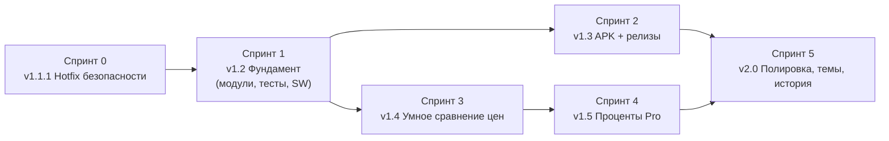

# ROADMAP — Калькулятор цен и процентов

Текущая версия в проде: **v1.1** (PR #1, 29.08.2026) · Live: https://thathouroff-create.github.io/price/
Команда и шлюзы: [`WEB_TEAMWORK.md` → Price Calculator pipeline](file:///D:/Antigravity/.agents/WEB_TEAMWORK.md) · Архитектура и карта уязвимостей: [`price-calc-architecture`](file:///D:/Antigravity/.agents/skills/price-calc-architecture/SKILL.md)

Базовый аудит (`price_audit.ps1`, 08.11.2026): **Critical 3 · High 4 · Medium 11 · Low 5 → FAILED**.

---

## Спринт 0 — v1.1.1 «Hotfix безопасности» (½ дня) 🔴

Цель: закрыть все Critical/High без изменения внешнего вида.

| # | Задача | Закрывает | Владелец |
| :--- | :--- | :--- | :--- |
| 0.1 | `render()` товаров через `createElement` + `input.value`; делегирование событий через `data-action`/`data-id` вместо `onclick="…${id}"` | PRC-01, PRC-02, PRC-11 | calc_frontend_engineer |
| 0.2 | `loadState()` с `try/catch`, валидацией схемы (id — safe integer, строки ≤ 60, ≤ 30 товаров), whitelists для `priceMode`/`activeTab` | PRC-02, PRC-04 | calc_frontend_engineer |
| 0.3 | `sw.js`: `APP_VERSION`, network-first для навигации, precache только same-origin, fallback `index.html` только для `mode==='navigate'` | PRC-03, PRC-05 | calc_frontend_engineer |
| 0.4 | Деление на ноль → понятное сообщение | PRC-09 | calc_frontend_engineer |
| 0.5 | Файл `VERSION`, `CHANGELOG.md` | REL-01 | calc_project_lead |

**AC:** AC-0.1 название `">` отображается как текст после перезагрузки · AC-0.2 `localStorage.priceProducts='{{{'` → приложение открывается с дефолтами · AC-0.3 после бампа версии открытая PWA получает новую версию максимум со 2-го запуска · AC-0.4 `30 от 0` → «на ноль делить нельзя» · `price_audit.ps1` = 0 Critical / 0 High.

## Спринт 1 — v1.2 «Фундамент» (1–2 дня) 🟠

| # | Задача | Закрывает |
| :--- | :--- | :--- |
| 1.1 | Разнести монолит: `css/app.css`, `js/calc-core.js` (чистые функции), `js/storage.js`, `js/ui-price.js`, `js/ui-percent.js`, `js/app.js` | — |
| 1.2 | `parseNum` (пробелы, NBSP, запятая, строгая проверка), `roundHalfUp`, `formatNum` (Intl ru-RU) | PRC-12, MATH-PARSE |
| 1.3 | `tests/calc-core.test.html` — эталонные векторы + крайние случаи + property-тесты | — |
| 1.4 | Локальные иконки `icons/192`, `512`, `maskable-512`; системный шрифт вместо Google Fonts; manifest `id`, `scope`, `lang`, `description`, `shortcuts` (`#price`, `#percent`) | PRC-06, PRC-07 |
| 1.5 | CSP `<meta>` (`default-src 'self'` …), убрать все inline-обработчики и inline-стили | PRC-06 |
| 1.6 | A11y: табы `<button role="tab">`, `<label for>`, контраст `--muted` ≥ 4.5:1, разрешить зум, `prefers-reduced-motion` | PRC-08, PRC-10 |
| 1.7 | Тост «Доступна новая версия — Обновить» (`registration.waiting`) | PRC-03 |

**AC:** `price_audit.ps1 -Strict` PASSED · `run_browser_tests.ps1` PASSED (≥ 60 проверок) · Lighthouse PWA/Accessibility ≥ 95 · приложение полностью работает в режиме «Офлайн» DevTools без единого внешнего запроса.

> [!NOTE]
> Иконки — бинарные файлы. Пуш через MCP: `push_files` с base64 или загрузка пользователем через веб-интерфейс GitHub (одна операция).

## Спринт 2 — v1.3 «APK и релизы» (1 день) 🟢

| # | Задача |
| :--- | :--- |
| 2.1 | Kotlin WebView-оболочка `D:\Antigravity\apk\PriceCalc` (WebViewAssetLoader, офлайн, без INTERNET-разрешения), сборка → `D:\Antigravity\apk\PriceCalc.apk` + Google Диск |
| 2.2 | Перенос оболочки в репозиторий `android/` + `.github/workflows/release-apk.yml` (тег `v*` → APK в GitHub Releases) |
| 2.3 | Кнопка «📲 Скачать APK» в вебе → `releases/latest/download/PriceCalc.apk` (скрыта внутри APK) + кнопка «Установить» (`beforeinstallprompt`) |
| 2.4 | Ключ подписи: создаёт **пользователь**, секреты `KEYSTORE_B64`, `KEYSTORE_PASS`, `KEY_ALIAS` в GitHub |
| 2.5 | *(опц.)* TWA: репозиторий `thathouroff-create.github.io` с `/.well-known/assetlinks.json` |

**AC:** APK ставится на BlueStacks, работает в авиарежиме, данные сохраняются после перезапуска, `versionName` = `VERSION`; push тега `v1.3.0` создаёт Release с APK.

## Спринт 3 — v1.4 «Умное сравнение цен» (1–2 дня) 🔵

- Единица у **каждого** товара (`г/кг/мл/л/шт`) с нормализацией; запрет сравнения г vs мл с подсказкой.
- Скидки и акции: «−X %», «2 по цене 1», «3 за N ₽», цена по карте.
- Многоупаковки: «6 × 0,5 л».
- Ничья — «одинаково выгодно»; сортировка по выгодности; экономия в ₽ на нужный объём («купите 2 кг — сэкономите 84 ₽»).
- Поделиться сравнением (Web Share API / ссылка с состоянием в `#hash`, с валидацией при чтении!).

## Спринт 4 — v1.5 «Проценты Pro» (1 день) 🟣

- Пересчёт «на лету» без кнопки (debounce 150 мс), кнопка-переключатель «поменять местами».
- Пояснение решения по шагам («30 / 200 × 100 = 15 %»).
- Новые режимы: НДС 20 % (выделить/начислить), наценка vs маржа, сложный процент / вклад, скидка из старой и новой цены, чаевые/деление счёта.
- Копирование результата по тапу, история последних 20 расчётов.

## Спринт 5 — v2.0 «Полировка» (1–2 дня) ⚪

- Темы Dark/Light/Auto (`prefers-color-scheme`), 3 акцентных палитры.
- Списки покупок / сохранённые сравнения.
- i18n (ru/en), экспорт/импорт данных (JSON с валидацией).
- Lighthouse 100/100/100/100, полный E2E-прогон Chrome + BlueStacks, скриншоты в README.

---

## Риски и решения

| Риск | Мера |
| :--- | :--- |
| Нет прав на upstream, MCP-токен истекает (401) | Работа через форк + PR; при 401 — просить переподключить GitHub |
| Пользователи застревают на старой версии из-за SW | `APP_VERSION` + network-first HTML + тост обновления (Спринт 0/1) |
| Общий origin `*.github.io` с другими проектами | Неймспейс ключей `price.v2.*`, валидация всех данных из хранилища |
| Блокировки CDN в РФ | Ноль внешних зависимостей (Спринт 1) |
| Потеря ключа подписи APK | Ключ у пользователя + резервная копия на Google Диске |
| Нет Node.js | Тесты в headless Chrome через `run_browser_tests.ps1` |
